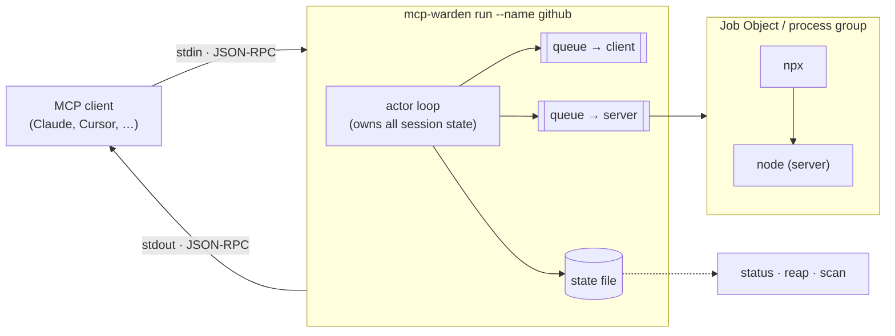
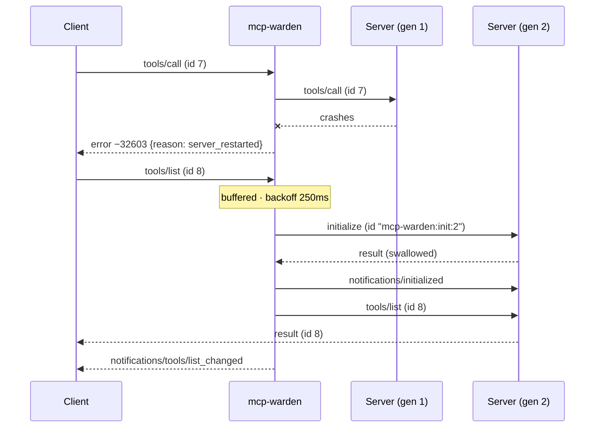

# mcp-warden

[](https://github.com/anthonycoffey/mcp-warden/actions/workflows/ci.yml)
[](https://pkg.go.dev/github.com/anthonycoffey/mcp-warden)


**A process supervisor for local [MCP](https://modelcontextprotocol.io) servers, and a scanner for the ones nobody is supervising.**

MCP clients such as Claude Desktop, Claude Code, Cursor and VS Code start local MCP servers
as child processes, usually through `npx` or `uvx`. That works until something goes wrong:

- **Leaks.** The client exits or reloads, the wrapper chain doesn't pass the signal on, and
  orphaned `node.exe` processes pile up until the machine starts to lag.
- **Crashes.** A server dies mid-session and its tools stay broken until you restart the
  whole client. Nothing records why it died.
- **No visibility.** Nothing tells you which servers are running, for how long, how often
  they crash, or how slow they are.

`mcp-warden` is one static Go binary that fixes all three.

```text
$ mcp-warden status
NAME     STATE    PID    CHILD  UPTIME  RESTARTS  REQS  ERRS  P50   P95    LAST EXIT
github   running  41220  41236  3h      1         214   1     38ms  410ms  exit status 1
figma    running  41301  41322  3h      0         57    0     12ms  95ms   -

Last scan 2m ago: 3 orphaned MCP trees (412 MB), 2 unmanaged, 0 detached, 2 managed
Run `mcp-warden scan` for details, `mcp-warden scan --kill` to clean up.
```

## Features

| | |
|---|---|
| **Transparent proxy** | Sits between client and server on stdio and relays every message byte-for-byte. The client can't tell it's there. |
| **Owns the whole process tree** | Puts the server in a Windows **Job Object** (kill-on-close) or a Unix process group. When the client closes, *every* descendant goes, even if `mcp-warden` itself is force-killed. |
| **Crash recovery without a client restart** | Restarts the server with exponential backoff, **replays the MCP handshake** to the new process, and answers any in-flight request with a clean error instead of a hang. Sends `list_changed` so the client refreshes its tool list. |
| **Circuit breaker** | If the server crash-loops (default: more than 5 crashes in 60s), it stops restarting and fails fast. |
| **Machine-wide orphan scan** | `scan` finds *every* MCP server process on the machine, wrapped or not. It classifies each process tree as `managed`, `unmanaged`, `orphaned` or `detached`, and can kill orphans safely. |
| **Leak history** | `watch` records changes to an append-only log. `history` answers *"which server keeps leaking, and how much memory did it cost?"* |
| **Zero dependencies** | Go standard library plus `golang.org/x/sys`. No cgo, no daemon, no ports. |

## Quick start

### 1. Install

```bash
go install github.com/anthonycoffey/mcp-warden/cmd/mcp-warden@latest
```

Or build from source with `make build`, which puts the binary in `bin/`.

### 2. See what's running right now

`scan` works before you've wrapped anything:

```text
$ mcp-warden scan
CLASS      PID    PROCS  MEM     AGE  OWNER                                 COMMAND
orphaned   18044  3      212 MB  2d   parent pid 9120 is no longer running  cmd.exe /d /s /c "npx -y @heroku/mcp-server"
orphaned   20112  2      124 MB  2d   parent pid 9120 is no longer running  node npx-cli.js -y firebase-tools mcp
unmanaged  60616  6      178 MB  19h  launched by Claude (pid 54760) wit…   cmd.exe /d /s /c "npx chrome-devtools-mcp@latest"

2 orphaned MCP trees (336 MB), 1 unmanaged, 0 detached, 0 managed; 41 unreadable processes skipped
Tip: wrap unmanaged servers with `mcp-warden run` so they are supervised and cleaned up.

$ mcp-warden scan --kill
Kill 2 orphaned trees? [y/N] y
killed tree at pid 18044: 3 process(es), 212 MB  cmd.exe /d /s /c "npx -y @heroku/mcp-server"
killed tree at pid 20112: 2 process(es), 124 MB  node npx-cli.js -y firebase-tools mcp
```

### 3. Wrap your servers

Put `mcp-warden run --name <name> --` in front of the existing command in your client config.

**Claude Desktop** (`claude_desktop_config.json`):

```jsonc
{
  "mcpServers": {
    "github": {
      // before: "command": "npx", "args": ["-y", "@modelcontextprotocol/server-github"]
      "command": "mcp-warden",
      "args": ["run", "--name", "github", "--", "npx", "-y", "@modelcontextprotocol/server-github"]
    }
  }
}
```

**Claude Code:**

```bash
claude mcp add github -- mcp-warden run --name github -- npx -y @modelcontextprotocol/server-github
```

Restart the client. `mcp-warden status` now shows the server, and `mcp-warden logs github -f`
follows its stderr.

> **Tip:** GUI clients don't always inherit your shell's `PATH`. If the server fails to start,
> use the absolute path to the binary, e.g.
> `"command": "C:\\Users\\you\\go\\bin\\mcp-warden.exe"` or `"/Users/you/go/bin/mcp-warden"`.

## How it works



1. **Relay.** Each message is classified (request, notification or response) by decoding
   only its envelope, then forwarded unchanged. In-flight requests are tracked, so latency
   is measured and nothing is left hanging after a crash.
2. **Supervise.** If the server exits unexpectedly, in-flight requests get a JSON-RPC error
   (`data.reason = "server_restarted"`). New requests are buffered, and the server restarts
   after a backoff.
3. **Restore the session.** The client's original `initialize` is replayed to the new
   server under a reserved id, and the response is swallowed. Then `initialized` is sent,
   the buffer is flushed, and `notifications/tools/list_changed` goes to the client.
4. **Report.** Every instance writes an atomically replaced JSON state file. `status`,
   `reap` and `scan` read those files, so there's no daemon and no open ports.



The full design is in [`docs/architecture.md`](docs/architecture.md).

## Commands

| Command | What it does |
|---|---|
| `run --name N -- CMD…` | Run `CMD` as a supervised MCP server. This is what goes in your client config. |
| `status [--json]` | Supervised instances, their health, and the latest scan summary. |
| `logs NAME [-f] [-n 100]` | Print or follow an instance's log (including the server's stderr). |
| `reap [--dry-run]` | Kill process trees left behind by `mcp-warden` instances that died. |
| `scan [--kill [--yes]] [--pid P] [--json]` | Classify every MCP process tree on the machine, and optionally kill orphans. |
| `watch [--interval 30s] [--auto-reap --min-age 5m]` | Scan continuously, log changes, and optionally clean up long-lived orphans. |
| `history [--since 7d] [--json]` | Orphans per day, the commands that leak most, and peak orphaned memory. |

The full flag reference is in [`docs/cli.md`](docs/cli.md).

### Safety rules for killing

`mcp-warden` only ever kills a process tree that it owns (`run`, `reap`) or that the scanner
classified as **orphaned** and you explicitly asked it to kill (`--kill` or `--auto-reap`).
Before every kill it re-reads the process's **creation time** and compares it to what it saw
before, so a process ID reused by an unrelated program is never touched. On Windows the check
and the kill go through the same process handle, so there's no window in between.

## Configuration

Run flags have sensible defaults (`mcp-warden run -h` lists them). For the scanner, an
optional `config.json` in the state directory *extends* the built-in patterns:

```json
{
  "match":   ["my-internal-tool --stdio"],
  "exclude": ["^vim "],
  "clients": [{ "label": "Acme IDE", "name": "^acme(\\.exe)?$" }]
}
```

| Platform | State directory |
|---|---|
| Windows | `%LOCALAPPDATA%\mcp-warden` |
| macOS | `~/Library/Application Support/mcp-warden` |
| Linux | `$XDG_STATE_HOME/mcp-warden` (default `~/.local/state/mcp-warden`) |

Override with `--state-dir` or `MCP_WARDEN_STATE_DIR`. The layout is described in
[`docs/cli.md#files`](docs/cli.md#files).

## Platform notes

| | Windows | Linux | macOS |
|---|---|---|---|
| Tree ownership | Job Object, kill-on-close | process group + `Pdeathsig` | process group |
| Survives the warden being `kill -9`'d | ✅ kernel kills the tree | ⚠️ direct child dies; grandchildren cleaned by `reap` | ⚠️ cleaned by `reap` |
| Process scan | Toolhelp + `NtQueryInformationProcess` | `/proc` | `sysctl` (`kern.proc`, `procargs2`) |
| Memory (RSS) in scans | ✅ | ✅ | not reported (needs cgo) |

## Development

```bash
make test     # unit + end-to-end tests
make race     # with the race detector (needs a C toolchain; CI runs it on all three OSes)
make lint     # golangci-lint
make vet      # go vet for windows, linux and darwin
make bench    # per-message proxy overhead (~50µs round trip in-memory)
make cross    # release binaries for six OS/arch targets
```

The repository is spec-driven: every feature starts as a spec in
[`docs/specs/`](docs/specs/), and decisions are recorded as ADRs in [`docs/adr/`](docs/adr/).
The testing strategy is in [`docs/testing.md`](docs/testing.md).

```
cmd/mcp-warden/      entry point
internal/
  proxy/             actor-model stdio relay, supervision, session replay
  restart/           backoff + circuit breaker (pure, clock-injected)
  procgroup/         Job Objects / process groups
  procscan/          per-OS process snapshots, identity-checked kills
  classify/          pure policy: snapshot → managed/unmanaged/orphaned/detached
  history/           scan diffs → JSONL events → summaries
  jsonrpc/           newline framing + envelope parsing
  state/ logfile/ metrics/ cli/
  fakeserver/        scriptable MCP server used by tests
e2e/                 drives the real binary against the fake server
docs/                architecture, CLI reference, testing, ADRs, specs
```

## Non-goals

- **Not a security gateway.** `mcp-warden` doesn't inspect or filter tool calls.
- **stdio only.** Streamable HTTP servers aren't proxied.
- **One server per warden.** Failures stay isolated; there's no multiplexing.

## License

[MIT](LICENSE)
