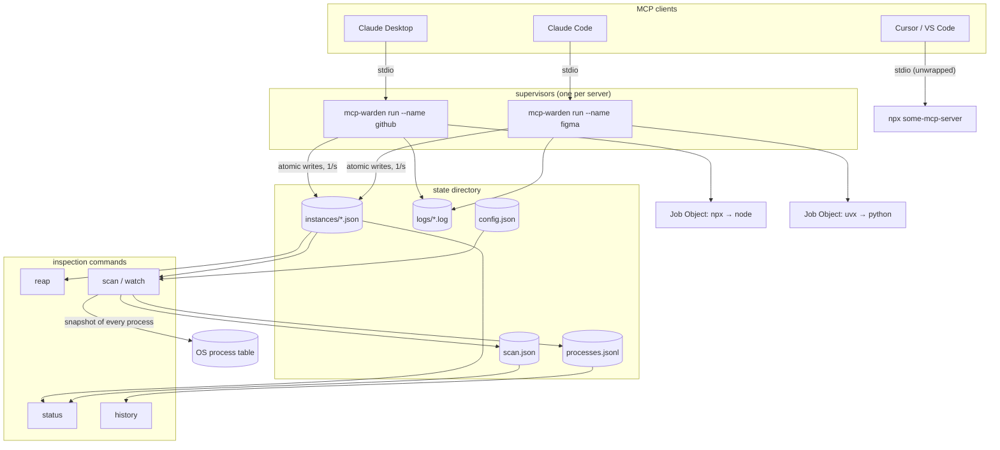
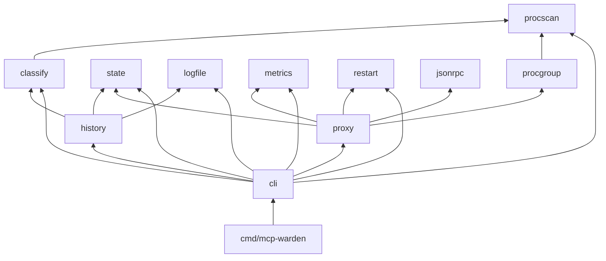
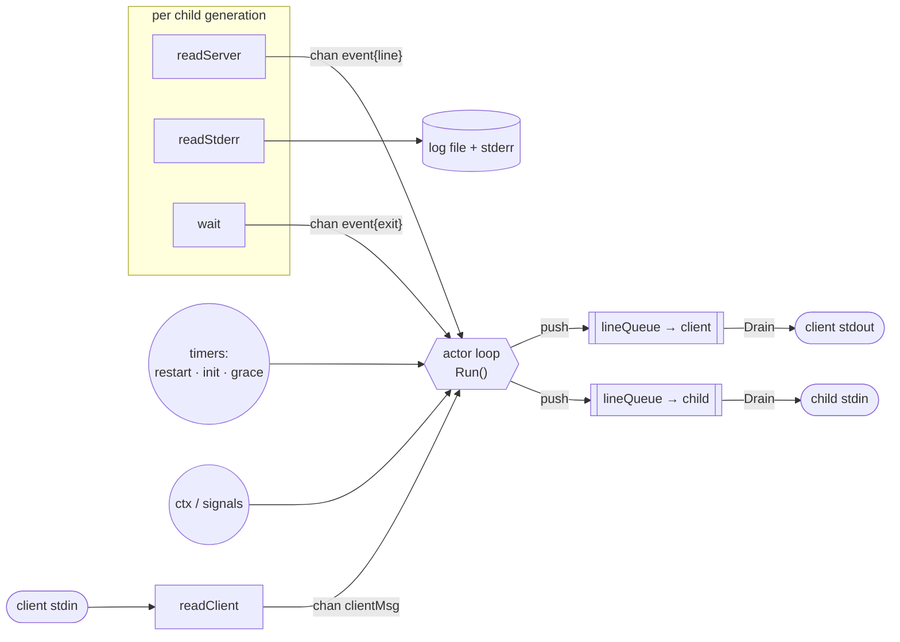
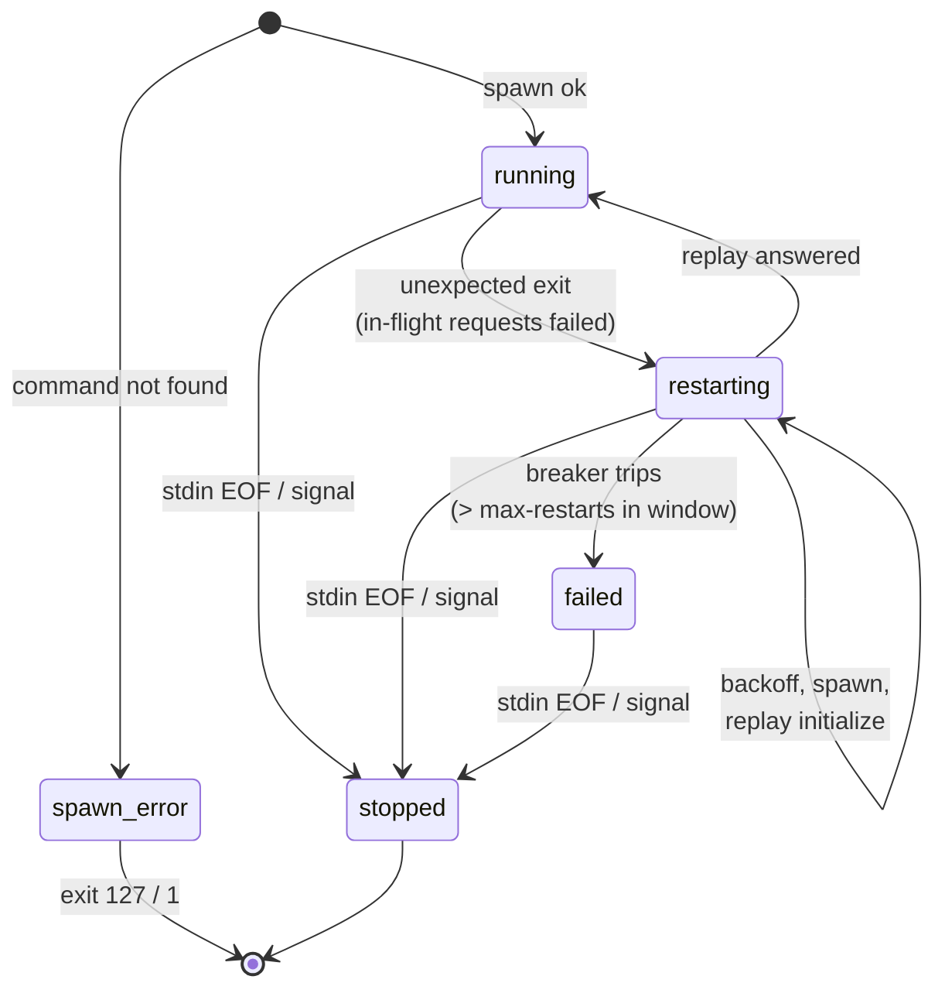
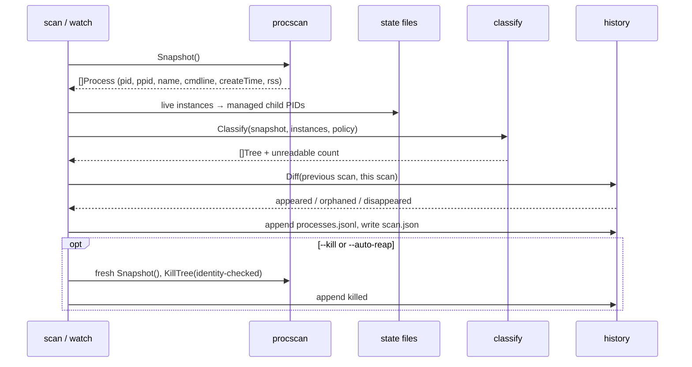

# Architecture

mcp-warden is two tools sharing one binary and one state directory:

- **The supervisor** (`run`): a long-lived, per-server stdio proxy that owns the server's
  process tree.
- **The scanner** (`scan`, `watch`, `history`, plus `status` and `reap`): short-lived commands
  that inspect the machine and the supervisors' state files.

They never talk to each other directly. The state directory is the only interface between
them (see [ADR-003](adr/ADR-003-state-files-not-daemon.md)).

## Packages

| Package | Responsibility | Talks to the OS? |
|---|---|---|
| `jsonrpc` | Newline framing with a size cap; envelope-only parse; error/notification builders | no |
| `restart` | Exponential backoff with jitter; sliding-window circuit breaker | no |
| `metrics` | Counters and a latency reservoir (p50/p95/max over the last 1024 requests) | no |
| `proxy` | The actor loop: relay, in-flight tracking, restart buffer, session replay | via `Child` |
| `procgroup` | Start a command so its whole tree can be killed (Job Object / process group) | yes |
| `procscan` | Snapshot every process; identity-checked kill; tree helpers | yes |
| `classify` | **Pure** policy: snapshot → classified trees | no |
| `history` | Diff scans → events; JSONL log; summaries | files |
| `state` | Instance schema, atomic JSON writes, directory layout | files |
| `logfile` | Size-rotating writer | files |
| `cli` | Flag parsing, commands, human and JSON output | — |

The OS-facing packages are kept thin. Everything with real decision logic (`classify`,
`restart`, `history`, the proxy's relay rules) is pure or sits behind an interface, which is
what makes the test suite fast and deterministic (see [testing.md](testing.md)).

## The supervisor

### Concurrency model

The proxy is an **actor**: one goroutine owns every piece of session state, and everything
that can block runs in another goroutine and talks to it through channels
([ADR-002](adr/ADR-002-actor-model-proxy.md)).

- **Push never blocks.** `lineQueue` is an unbounded FIFO drained by its own writer
  goroutine. If the server stops reading its stdin, the actor keeps going, so server output
  keeps flowing to the client and the classic two-pipe deadlock can't happen.
- **One writer per stream.** Relayed messages and messages mcp-warden makes up itself (errors,
  `list_changed`) go through the same queue, so lines never interleave.
- **Generations.** Each child process is a numbered generation with its own reader, waiter
  and queue. Events carry their generation number, and the actor ignores anything from a
  generation that is no longer current.
- **Exit after output.** The `wait` goroutine sends the exit event only after the stdout
  reader has drained, so "server exited" is always ordered after the server's last message.
  After the direct child exits it also kills the rest of the tree, which closes any pipe
  handles grandchildren were holding.

### Lifecycle

On shutdown the proxy closes the server's stdin (the MCP stdio shutdown signal), waits up
to `--grace`, then kills the tree. A clean exit deletes the instance's state file, so a state
file that is still there always means "this warden died", which is exactly what `reap` looks
for.

### State publishing

`run` publishes an `Instance` record (schema in [cli.md](cli.md#files)) once a second, and
within 250 ms of any phase change. It records the child's **OS creation time** rather than
mcp-warden's own clock, so `reap` can prove a PID still belongs to the same process before
killing it ([ADR-004](adr/ADR-004-creation-time-identity.md)).

## The scanner

Classification rules, tree grouping, and the safety argument for killing are covered in
[process-ownership.md](process-ownership.md).

## Error handling philosophy

- **The protocol channel is sacred.** Nothing but JSON-RPC messages ever reaches the
  client's stdout. All diagnostics go to stderr (which clients capture into their own logs)
  and to the instance log file.
- **Never leave a request hanging.** Every request is either answered by the server or by
  mcp-warden: on crash (`server_restarted`), on a full buffer (`restart_buffer_full`), with
  the circuit open (`circuit_open`), or when a message is too large (`message_too_large`).
- **Degrade rather than fail.** A process the scanner can't read is counted as
  `unreadable`, not guessed at. If Job Object assignment fails, the supervisor falls back to
  killing the tree by walking it, and logs a warning.
