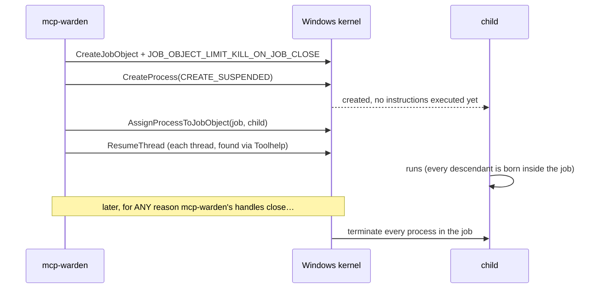
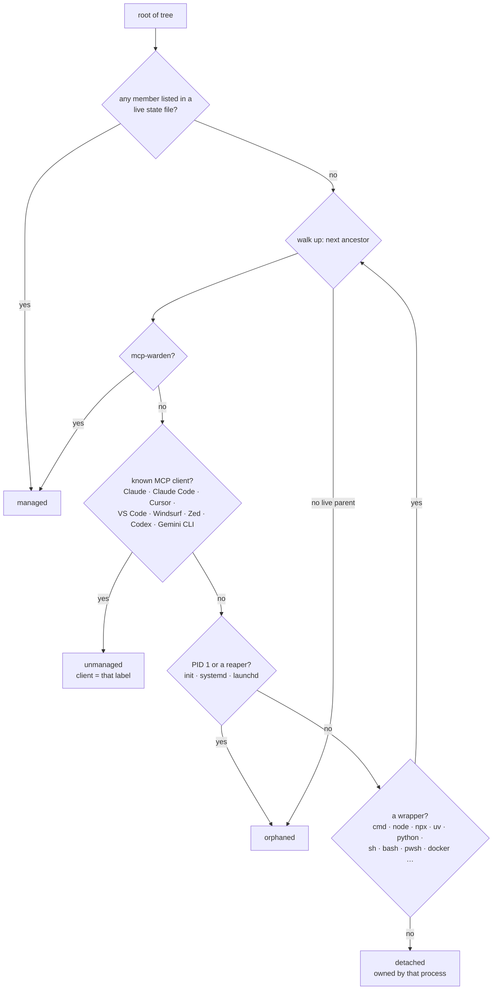
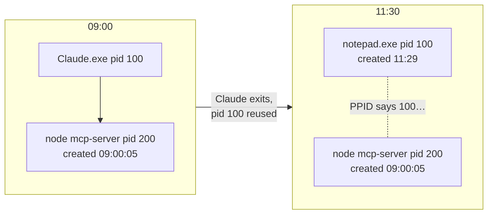

# Process ownership and orphan detection

Two questions run through this whole project:

1. *For the servers mcp-warden starts:* how do we make sure nothing outlives them?
2. *For every other MCP process on the machine:* who owns it, and is it safe to kill?

## Owning a process tree

MCP servers are rarely a single process. `npx -y some-server` on Windows is typically
`cmd.exe → node (npx) → node (server)`, sometimes with a `conhost.exe` on the side.
Killing the direct child is not enough.

### Windows: Job Objects

- **Created suspended**, so the child can't start a grandchild before it's in the job.
  `exec.Cmd` doesn't expose the main thread handle, so the threads are found with a
  Toolhelp snapshot and resumed one by one.
- **Kill-on-close** means the kernel enforces cleanup. Even `taskkill /F` on mcp-warden,
  a crash, or a power-user "End task" can't leave the tree behind. This is the property that
  fixes the original leaked-`node.exe` problem.
- **Nested jobs** (Windows 8+) let this work even when the client already runs mcp-warden
  inside its own job. If assignment still fails, mcp-warden logs a warning and falls back to
  walking the tree with `procscan` when it kills.

### Linux and macOS: process groups

The child starts with `Setpgid`, so it leads a new process group, and `kill(-pgid, SIGKILL)`
reaches every descendant that didn't deliberately leave the group. On Linux, `Pdeathsig`
additionally kills the direct child if mcp-warden dies.

The honest gap: if mcp-warden is `kill -9`'d on Unix, grandchildren can survive. That's why
`reap` exists, and why every instance records its child's PID and creation time.

## Classifying everything else

`scan` takes a snapshot of every process and keeps those that look like MCP servers. The
policy lives in `internal/classify`, a pure function with no OS calls.

### 1. Find candidates

A process is a candidate when its command line matches a **match** pattern and no
**exclude** pattern. The defaults:

| Pattern | Catches |
|---|---|
| `@modelcontextprotocol/` | the official server packages |
| `mcp` as a token (`(^\|[^a-z0-9])mcp([^a-z0-9]\|$)`) | `figma-mcp`, `mcp-server-fetch`, `mcp_server.py`, `docker run mcp/github` |
| `mcp-?server` | `mcpserver`, `mcp-server` |
| `fastmcp` | FastMCP-based Python servers |

Never candidates: mcp-warden itself (by executable name), known **clients** (Claude Code is
`node …/claude-code/cli.js --mcp-config …`, which would otherwise match), and unreadable
processes. The text `mcp-warden` is removed before matching, so a shell running
`mcp-warden status` isn't a server, but `node …/mcp-warden/examples/figma-mcp.js` still is.

### 2. Group into trees

A candidate with a candidate ancestor belongs to that ancestor's tree. The topmost candidate
is the **root**, and the tree is the root plus *all* of its descendants, whether or not they
match. This is the unit that gets reported, measured (summed RSS) and killed.

### 3. Decide ownership

The **wrapper** rule matters. `client → cmd.exe → npx → server` is unmanaged, not detached,
because `cmd.exe` and `npx` are only launchers. And `dead client → cmd.exe → server` is an
orphan even though `cmd.exe` is still alive.

### What a "live parent" means

A process's parent link is trusted only if the parent PID exists **and** the parent was
created no later than the child. Otherwise the original parent died and its PID was reused
by an unrelated process. This matters most on Windows, which never re-parents orphans: a
Windows orphan's PPID points at a dead process, or at whichever program later reused that
number.

`notepad.exe` was created after the server, so it can't be the server's parent. The server
is classified **orphaned**.

## Safety rules for killing

1. **Only orphans, only on request.** `scan --kill` (with confirmation, or `--yes`) and
   `watch --auto-reap` touch nothing but `orphaned` trees. `--pid` narrows it further.
2. **Fresh snapshot.** Kills use a new snapshot, not the one that was displayed, so the
   current set of descendants is killed.
3. **Identity check.** Each process is killed only if its creation time still matches
   ([ADR-004](adr/ADR-004-creation-time-identity.md)). On Windows the check and
   `TerminateProcess` share a handle, so there's no race. On Linux and macOS the window
   between check and kill is microseconds.
4. **Deepest first.** Descendants die before their parents, so nothing gets a chance to
   respawn a child.
5. **Debounced auto-reap.** `--auto-reap` waits until a tree has been continuously orphaned
   for `--min-age` (default 5 minutes). A client restarting between two scans never loses
   its servers.

## Per-OS implementation notes

| | Windows | Linux | macOS |
|---|---|---|---|
| Enumerate | `CreateToolhelp32Snapshot` | `/proc/<pid>` | `sysctl kern.proc.all` |
| Command line | `NtQueryInformationProcess(ProcessCommandLineInformation)`. Needs only `PROCESS_QUERY_LIMITED_INFORMATION`, no PEB reads | `/proc/<pid>/cmdline` | `sysctl kern.procargs2` |
| Creation time | `GetProcessTimes` | `/proc/<pid>/stat` field 22 + `btime` | `kinfo_proc.p_starttime` |
| Memory | `ProcessVmCounters.WorkingSetSize` | `stat` RSS × page size | not available without cgo |
| Liveness | `GetExitCodeProcess == STILL_ACTIVE` (an exited process stays openable while handles exist) | `stat` state not `Z`/`X` | `sysctl kern.proc.pid` |

Processes of other users or elevated processes are often unreadable without admin rights.
They're counted (`N unreadable processes skipped`) and never classified or killed.
