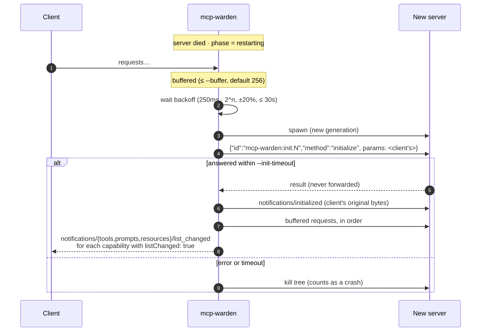

# Protocol handling

This page specifies what `mcp-warden run` does with every byte that passes through it.
The target is the MCP stdio transport (spec revision 2025-06-18): UTF-8 JSON-RPC 2.0
messages, one per line, no embedded newlines.

## Relay rules

| Rule | Detail |
|---|---|
| **Bytes in = bytes out** | Forwarded messages are the original bytes, never re-encoded. Key order, whitespace and number formatting survive. |
| **Envelope-only parsing** | Only `id`, `method`, and whether `result`/`error` is present are decoded (into `json.RawMessage`), and only to make routing decisions. `params` and `result` are touched only for `initialize`, its result, and `notifications/cancelled`. |
| **Unknown is fine** | Unknown methods, fields, and protocol revisions pass straight through. |
| **Malformed server output** | Relayed unchanged (the client decides what to do with it), counted as an error, and logged. |
| **Size limit** | Default 16 MiB per message (`--max-message`). A larger line is discarded up to the next newline. If an `id` can be recovered from the first 256 bytes, the waiting side gets an error with `reason: message_too_large`. Either way the stream stays usable. |
| **Batches** | JSON arrays (allowed by revision 2025-03-26) are relayed as-is. Their elements are tracked for in-flight bookkeeping. |
| **stdout is protocol only** | mcp-warden never prints anything else to its stdout. Diagnostics go to stderr and the log file. |

## In-flight tracking

Every client→server **request** is recorded by id together with its method and start time,
and removed when:

- the server responds (its latency is recorded for p50/p95/max), or
- the client sends `notifications/cancelled` for that id (so no error is sent for it later), or
- the server dies, in which case mcp-warden answers it itself:

```json
{"jsonrpc":"2.0","id":7,"error":{"code":-32603,
  "message":"MCP server restarted while handling tools/call",
  "data":{"reason":"server_restarted"}}}
```

Ids are compared by their compact JSON encoding, so `1` and `"1"` are different requests,
as JSON-RPC requires.

## Server→client requests

Servers can send requests too (`sampling/createMessage`, `roots/list`, `elicitation/create`).
mcp-warden records which **generation** of the server sent each one. When the client answers:

- if the generation that asked is still running, the response is forwarded;
- if that generation has since died, the response is **dropped**. The new process never
  asked, and an unsolicited response could confuse it.

## Restart and session replay

MCP is stateful: a server rejects requests until it has completed the `initialize` /
`notifications/initialized` handshake. A naive restart would leave the client talking to an
uninitialized server. mcp-warden captures the handshake and replays it.

**What is captured**

| From the client | Used for |
|---|---|
| `initialize` params | replayed verbatim to each new generation |
| `initialize` id | recognizing the original response |
| `notifications/initialized` (raw bytes) | replayed after the replayed `initialize` succeeds |

| From the original server | Used for |
|---|---|
| `result.protocolVersion` | a warning if a restarted server negotiates something different |

The session counts as *established* once the server successfully answers the client's
`initialize`. If the server dies before that, there is nothing to replay: the client's
`initialize` gets a `server_restarted` error and the client is expected to retry.

**The sequence**



**Reserved ids.** Ids injected by mcp-warden are strings prefixed with `mcp-warden:`.
Clients use numbers or UUIDs, so a collision isn't a practical concern, and the convention
is documented here so it can be checked.

**Why `list_changed`?** A new process may expose different tools, for example after an
`npx` package update. The client is told to re-fetch only the lists the server says can
change.

## Synthesized errors

All of them use code `-32603` (internal error), except oversized client messages, which
use `-32600` (invalid request). The `data.reason` field tells a client, or a human reading
logs, exactly what happened:

| `data.reason` | When |
|---|---|
| `server_restarted` | The request was in flight when the server died. |
| `restart_buffer_full` | The server is restarting and `--buffer` messages are already waiting. |
| `circuit_open` | The server crash-looped (`--max-restarts` within `--restart-window`) and won't be restarted. |
| `message_too_large` | The request, or the server's response to it, exceeded `--max-message`. |

Notifications are never answered (JSON-RPC forbids it). While restarting they're buffered
like requests. With the circuit open they're dropped.

## Restart policy

| Flag | Default | Meaning |
|---|---|---|
| `--backoff-base` | 250ms | First restart delay. |
| `--backoff-max` | 30s | Delay cap. |
| *(factor, jitter)* | 2, ±20% | Exponential growth, spread to avoid lockstep restarts. |
| `--max-restarts` | 5 | Crashes allowed within the window… |
| `--restart-window` | 60s | …after which the circuit opens. |
| `--init-timeout` | 10s | Time for a new generation to answer the replayed `initialize`. |

The backoff attempt number is the count of crashes inside the window, so a server that has
been stable for a full window starts again from the base delay.

A server that **fails to spawn at all** on the first try (command not found, not executable)
isn't retried: mcp-warden exits with code 127 (not found) or 1, because a missing binary
won't appear by waiting.

## Shutdown

| Trigger | Behavior |
|---|---|
| Client closes stdin (EOF) | Close the server's stdin, wait `--grace` (3s), kill the tree, exit 0. |
| SIGINT / SIGTERM | Same as EOF. |
| mcp-warden killed hard | Windows: the kernel closes the Job Object and kills the tree. Unix: the direct child gets `SIGKILL` via `Pdeathsig` (Linux), and the rest is left for `reap`. |
