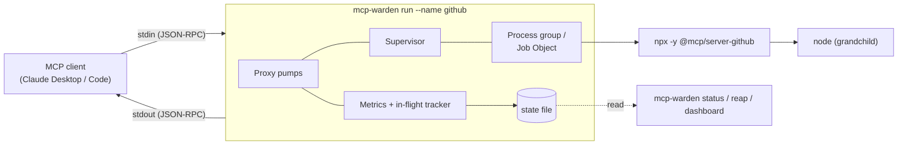
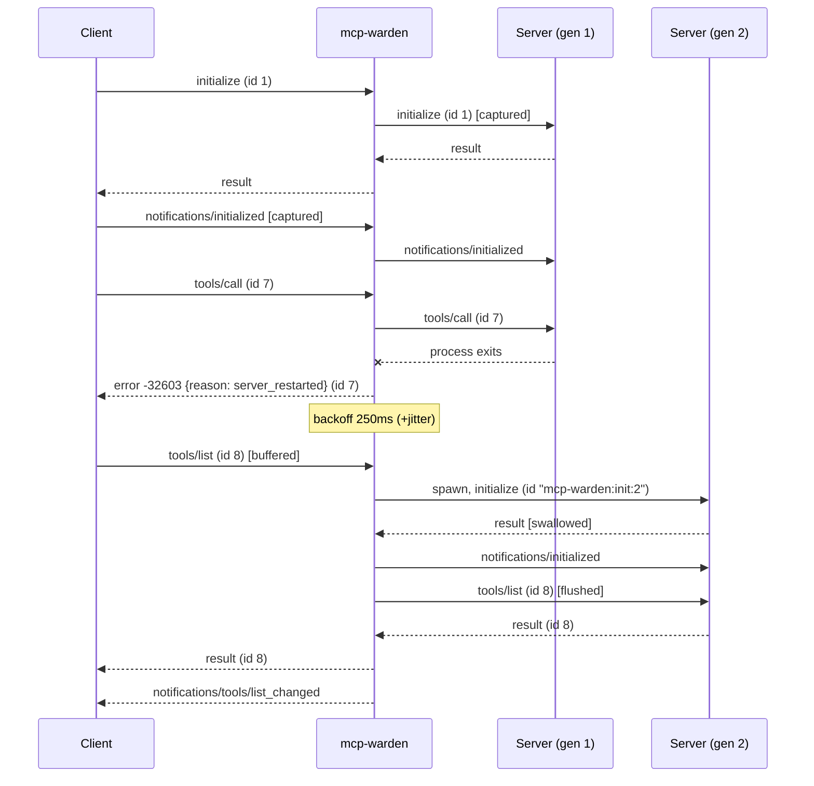
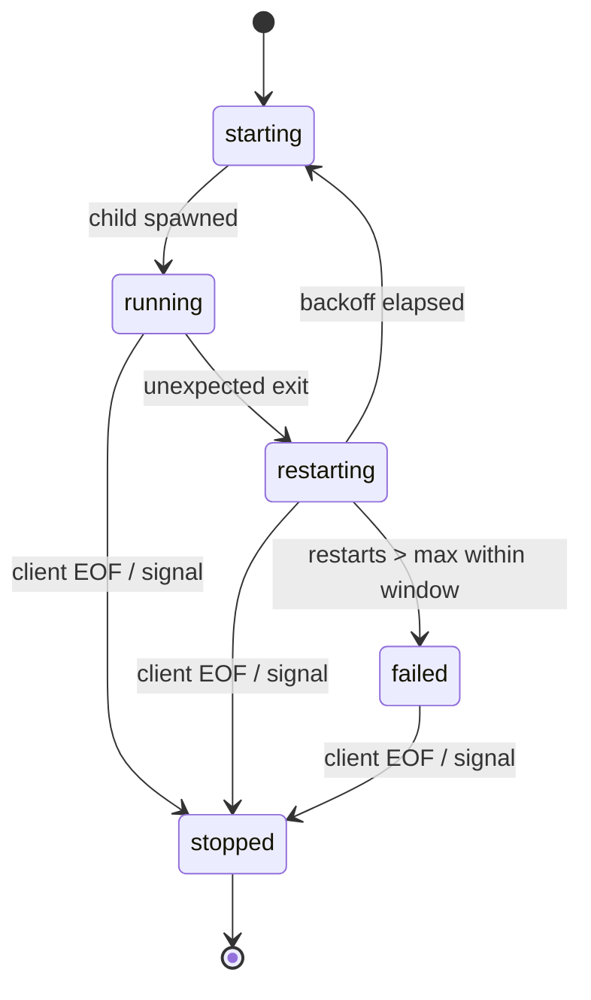
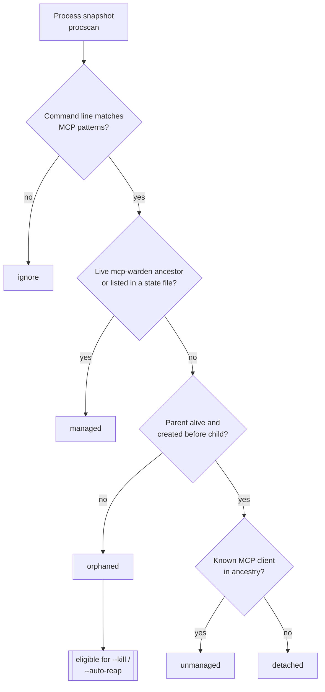
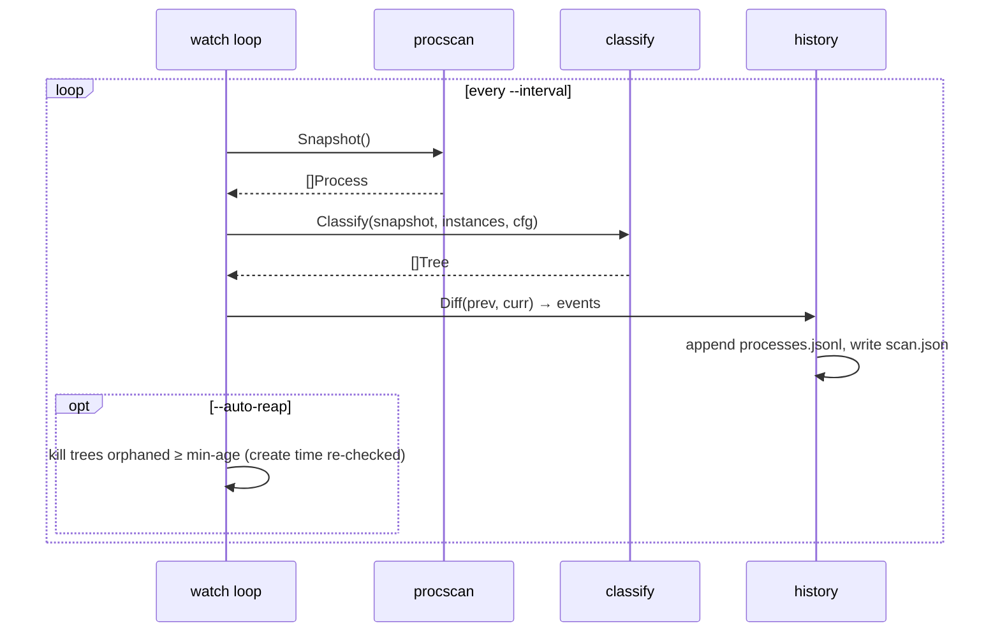

## Reviewer Notes

<!-- Leave empty until code review. When requesting changes, reviewer adds feedback here: -->

---

# Feature: mcp-warden prototype

## Problem

MCP clients (Claude Desktop, Claude Code, Cursor, VS Code) launch local MCP servers as child
processes and talk to them over stdio. In practice those servers are usually started through
`npx`/`uvx`, which adds layers of wrapper processes, and the lifecycle is fragile:

- **Orphans.** When the client exits, crashes, or reloads a server, the wrapper chain often
  doesn't pass termination down to its children. Grandchild `node.exe` processes pile up
  (we observed 26 leaked processes on one machine, enough to cause visible input lag).
- **Flapping.** A server that crashes takes the whole tool integration with it until the user
  restarts the client. Nothing restarts it, nothing records why it died, and nothing limits
  how often it can crash-loop.
- **No visibility.** There's no single place to see which servers are running, how long
  they've been up, how many times they've died, or how slow their tool calls are. stderr goes
  to client-specific log files that are hard to find.

- **Leaks outside any wrapper.** Even with a supervisor in place, most servers on a machine
  won't be running through it: servers that aren't wrapped yet, other clients (Cursor, VS
  Code), and leftovers from before installation. These orphans keep piling up and nothing
  points them out.

`mcp-warden` is a single static Go binary that sits between the MCP client and the real server.
Its stdio is transparent, so the client doesn't know it's there. It owns the server's whole
process tree, restarts the server after a crash and restores the MCP session, and records
health so a `status` command can report it. It also scans the whole machine for MCP server
processes it does *not* manage, classifies them, flags orphans, and tracks them over time.

## Requirements

### Must have

**Proxying**

1. WHEN started as `mcp-warden run --name <name> -- <command> [args...]`, the system SHALL
   spawn `<command>` and relay newline-delimited JSON-RPC messages client→server (its stdin →
   child stdin) and server→client (child stdout → its stdout), byte-for-byte unmodified.
2. The system SHALL NEVER write anything other than relayed protocol messages to its own
   stdout. All diagnostics go to stderr and the instance log file.
3. WHEN a single message exceeds 64 KiB, the system SHALL still relay it intact, up to a
   configurable maximum (default 16 MiB). Larger messages are reported as an error and do not
   crash the proxy.
4. WHEN the child writes to its stderr, the system SHALL copy it to the instance log file
   (rotated at 10 MiB, 3 backups kept) and to its own stderr, so the client's existing log
   capture keeps working.

**Process-tree ownership (orphan prevention)**

5. WHEN spawning the child on Windows, the system SHALL assign it to a Job Object with
   `JOB_OBJECT_LIMIT_KILL_ON_JOB_CLOSE`, so the whole tree is terminated even if
   `mcp-warden` itself is killed with no chance to clean up.
6. WHEN spawning the child on Linux/macOS, the system SHALL place it in a new process group
   (and, on Linux, set `Pdeathsig`), and SHALL signal the whole group on shutdown.
7. WHEN the client closes `mcp-warden`'s stdin (EOF) or sends SIGINT/SIGTERM, the system SHALL
   shut down gracefully: close the child's stdin, wait up to `--grace` (default 3s), then kill
   the process tree, then exit 0.

**Supervision and session recovery**

8. WHEN the child exits unexpectedly, the system SHALL restart it using exponential backoff
   with jitter (default base 250ms, factor 2, cap 30s).
9. WHEN the child has crashed more than `--max-restarts` times (default 5) within
   `--restart-window` (default 60s), the system SHALL stop restarting (circuit open), answer
   every later client request with a JSON-RPC error, and record state `failed`.
10. WHILE a restart is in progress, the system SHALL buffer client→server messages (bounded,
    default 256 messages). If the buffer fills, it SHALL reject the excess requests with a
    JSON-RPC error instead of blocking the client.
11. WHEN the child dies with client requests still in flight, the system SHALL immediately
    answer each in-flight request with JSON-RPC error `-32603` and
    `data.reason = "server_restarted"`, so the client never hangs waiting.
12. WHEN the client has already completed the MCP handshake and the child is restarted, the
    system SHALL replay the client's original `initialize` request (using a warden-reserved
    request id) and the `notifications/initialized` notification to the new child. It SHALL
    swallow the replayed `initialize` response, then flush buffered client messages.
13. WHEN the restarted server's capabilities advertise `listChanged` for tools, prompts, or
    resources, the system SHALL send the matching `notifications/*/list_changed` to the
    client, so the client re-fetches lists that may have changed.
14. WHEN the server sends a request to the client (e.g. `sampling/createMessage`,
    `roots/list`) and the server then restarts, the system SHALL drop the client's late
    response to that request instead of sending it to the new child.

**Observability**

15. WHILE running, each instance SHALL write a state file (atomic write-and-rename, at most
    once per second) to `<state-dir>/instances/<name>.json`. It contains: name, command,
    warden PID, child PID, state (`starting|running|restarting|failed|stopped`), started-at,
    last-restart-at, restart count, last exit reason, request/notification/error counts, and
    p50/p95/max request latency.
16. WHEN the user runs `mcp-warden status`, the system SHALL print a table of all instances
    and mark any whose warden PID is no longer alive as `stale`. `--json` SHALL output the
    same data as JSON.
17. WHEN the user runs `mcp-warden logs <name> [-f]`, the system SHALL print (and with `-f`,
    follow) that instance's log file.
18. WHEN the user runs `mcp-warden reap [--dry-run]`, the system SHALL find state files whose
    warden is dead but whose child PID still exists with a matching start time, kill those
    process trees, delete the stale state files, and report what it did.

**Machine-wide orphan scanning (processes outside warden's control)**

19. WHEN the user runs `mcp-warden scan`, the system SHALL enumerate every process on the
    machine (PID, parent PID, executable, command line, create time, resident memory) and
    select **MCP candidates**: processes whose command line matches the default MCP patterns
    (e.g. `@modelcontextprotocol/`, `mcp-server`, `-mcp`, `mcp_`, `fastmcp`) or user-supplied
    `--match <regex>` patterns (repeatable, also settable in config).
20. The system SHALL put each candidate in exactly one class:
    - `managed`: has a live `mcp-warden` ancestor, or its PID is listed in a live instance's
      state file.
    - `unmanaged`: not managed, but its ancestry reaches a live, known MCP client (Claude,
      Claude Code, Cursor, VS Code, Windsurf; the list is configurable).
    - `orphaned`: not managed, and its parent is dead or was re-parented (Linux/macOS: PPID 1
      or a subreaper; Windows: the parent PID is gone, or belongs to a process created *after*
      the child, which means the PID was reused).
    - `detached`: alive and has a live parent, but no known client in its ancestry.
      Reported, never killed by default.
21. The system SHALL group candidates into **trees** (an orphaned `npx` and its `node`
    grandchild count as one finding) and report per tree: root PID, class, client (if any),
    age, process count, and total memory. Output is a table by default, or `--json`.
22. WHEN the user runs `mcp-warden scan --kill`, the system SHALL kill only `orphaned` trees,
    print what it will kill, and require interactive confirmation or `--yes`. It SHALL never
    kill `managed`, `unmanaged`, or `detached` trees, and SHALL re-check each PID's create
    time immediately before killing it.
23. WHEN the user runs `mcp-warden watch [--interval 30s]`, the system SHALL scan repeatedly
    and append **change events** to `<state-dir>/processes.jsonl`. Event types:
    `appeared`, `orphaned` (a tree changed class to orphaned), `disappeared`, `killed`. Each
    event records PID, class, command, memory, and timestamp. The latest full snapshot SHALL
    be written atomically to `<state-dir>/scan.json`.
24. WHILE `watch` is running with `--auto-reap --min-age <dur>` (opt-in, off by default), the
    system SHALL kill orphaned trees that have stayed orphaned for at least `--min-age`
    (default 5m), applying the same safety checks as `--kill`.
25. WHEN the user runs `mcp-warden status`, the system SHALL also show a summary line from
    the most recent scan (e.g. `3 orphaned MCP trees (412 MB), 2 unmanaged`), and how old
    that scan is.
26. WHEN the user runs `mcp-warden history [--since 24h] [--json]`, the system SHALL
    summarize `processes.jsonl`: orphans per day, the commands that leak most often (with
    their totals), and peak orphaned memory. This answers "which server keeps leaking?".

**Engineering quality (portfolio bar)**

27. The project SHALL build with `go build ./...` on Windows, Linux, and macOS, with no cgo.
28. The project SHALL use only the Go standard library plus `golang.org/x/sys`. Anything else
    needs a justification recorded in an ADR. (Process enumeration is implemented in-house
    per OS, not with gopsutil. See ADR-001.)
29. `go test -race ./...` SHALL pass on all three OSes in CI (GitHub Actions matrix), and
    `golangci-lint` SHALL pass.

### Nice to have

- `mcp-warden dashboard`: a localhost HTML page (embedded with `embed`, auto-refreshing) that
  aggregates every instance's state file.
- `mcp-warden wrap <client-config.json> [--dry-run]`: rewrites a Claude Desktop/Code config so
  every stdio server runs under `mcp-warden`. Writes a timestamped backup and prints a diff.
- Hang detection: `--health-interval` sends an MCP `ping` to the child and restarts it after
  N consecutive timeouts.
- `--trace` mode: writes a redacted JSONL transcript of the session (methods, ids, timing,
  sizes, but no params or results by default).
- Release automation with GoReleaser (Windows/Linux/macOS binaries, checksums).
- Orphan alerts: `watch --alert-count N --alert-mb M` triggers a desktop notification or
  a Slack webhook when orphans cross a threshold.
- `mcp-warden watch --install`: registers `watch` as a per-user background task (Windows Task
  Scheduler, a systemd user unit, or a launchd agent).
- `scan` suggests a ready-to-paste `mcp-warden run` config snippet for each `unmanaged`
  server.

### Non-goals (what this does NOT do)

- This spec does NOT cover MCP over HTTP/SSE (Streamable HTTP) transports. Only stdio.
- This spec does NOT inspect, modify, filter, or policy-check tool calls. It's a supervisor,
  not a security gateway. (A policy layer is a candidate follow-up spec.)
- This spec does NOT multiplex several servers behind one process. It's one warden per
  server, which keeps failures isolated.
- This spec does NOT install or update MCP servers.

## Design

### Where it sits



Client config change (the only thing a user has to do):

```jsonc
// before
"github": { "command": "npx", "args": ["-y", "@modelcontextprotocol/server-github"] }
// after
"github": { "command": "mcp-warden", "args": ["run", "--name", "github", "--", "npx", "-y", "@modelcontextprotocol/server-github"] }
```

### Package layout

```
cmd/mcp-warden/          main: subcommand dispatch (stdlib flag), signal wiring
internal/jsonrpc/        line framing (bufio.Reader, max-size guard), lightweight envelope
                         parse (id, method, has-result/error) via json.RawMessage
internal/proxy/          the two pump goroutines, in-flight tracker, restart buffer,
                         handshake capture + replay
internal/supervisor/     child lifecycle state machine, backoff, circuit breaker
internal/procgroup/      Start/Kill a process tree. procgroup_windows.go (Job Objects via
                         x/sys/windows), procgroup_unix.go (Setpgid, Pdeathsig)
internal/state/          state file schema, atomic writer, reader, liveness checks
internal/metrics/        counters + latency reservoir for percentiles (mutex-guarded)
internal/logfile/        size-rotating writer
internal/procscan/       machine-wide process snapshot. procscan_windows.go
                         (CreateToolhelp32Snapshot + NtQueryInformationProcess for command
                         line + GetProcessTimes/memory), procscan_linux.go (/proc),
                         procscan_darwin.go (sysctl kern.proc + KERN_PROCARGS2 via x/sys/unix)
internal/classify/       pure functions: snapshot + live instances + config → classified
                         trees (no OS calls, so it's fully table-testable)
internal/history/        processes.jsonl event writer, snapshot diffing, history summaries
internal/cli/            status / logs / reap / scan / watch / history + table output
testdata/fakeserver/     scriptable fake MCP server used by integration tests
```

### Concurrency model

- One goroutine per direction (`clientToServer`, `serverToClient`), plus one for child stderr,
  one for the supervisor loop, and one ticker for state flushing. They're all tied to a root
  `context.Context` that is cancelled on shutdown.
- Each child **generation** gets its own pipes and its own server→client pump. The
  client→server pump is long-lived and writes through a `generation` handle that the
  supervisor swaps under a mutex. While the handle is nil (restarting), messages go to the
  bounded buffer.
- All writes to the client's stdout go through one writer goroutine fed by a channel, so
  relayed messages and warden-synthesized errors/notifications can never interleave
  mid-line.

### Restart and session-recovery sequence



### Supervisor state machine



### Orphan scanning

`scan` and `watch` don't depend on the proxy at all. They work on any machine, even before a
single server is wrapped, which makes them the easiest way to adopt the tool: "run `scan`,
see your leaks."





Design notes:

- `procscan` returns plain structs. `classify` is pure and has no OS calls, so all the
  classification logic is tested with hand-built snapshots (PID reuse, re-parenting,
  multiple clients, nested npx → node chains).
- Trees are keyed by `(rootPID, rootCreateTime)`, so diffing across scans is stable even
  when PIDs get reused.
- On Windows, the parent-liveness check compares create times, because Windows never
  re-parents and a "live" PPID may belong to an unrelated process that reused the PID.
- Processes that can't be read (access denied for other users or elevated processes) are
  counted and reported as `unreadable`, never guessed at.

### Key decisions

| Decision | Choice | Why |
| --- | --- | --- |
| CLI framework | stdlib `flag` + small dispatcher | Four subcommands don't justify Cobra, and a minimal dependency tree is part of the pitch. |
| Logging | `log/slog`, JSON handler to file, text handler to stderr | Standard library, structured. |
| JSON parsing | Envelope-only decode into `json.RawMessage`. The original bytes are what get forwarded. | Messages relay byte-for-byte, it's cheap, and there's no risk of re-encoding changing semantics. |
| State sharing | Per-instance JSON files, atomic rename | No daemon, no ports, survives crashes, trivially inspectable. |
| Windows tree kill | Job Object, `KILL_ON_JOB_CLOSE` | The only mechanism that still holds when the warden is hard-killed. |
| Reserved ids | String ids prefixed `mcp-warden:` | MCP clients use numeric or UUID ids, so a prefix collision is practically impossible, and it's documented. |
| Process enumeration | In-house per-OS (`procscan`), not gopsutil (ADR-001) | Keeps the dependency promise. The surface needed is small (pid, ppid, cmdline, create time, RSS), and the OS-level code is itself part of the showcase. |
| Orphan matching | Command-line regex patterns + known-client list, both configurable | Simple and explainable. A false positive is surfaced but never auto-killed unless it's `orphaned` and the user opted in. |
| Scan history | Append-only JSONL events + latest snapshot | Greppable, no database, and `history` aggregates it cheaply. |

### State file schema (v1)

```json
{
  "schema": 1,
  "name": "github",
  "command": ["npx", "-y", "@modelcontextprotocol/server-github"],
  "wardenPid": 41220,
  "childPid": 41236,
  "childStartedAt": "2026-10-12T15:04:05Z",
  "state": "running",
  "startedAt": "2026-10-12T15:00:00Z",
  "lastRestartAt": "2026-10-12T15:04:05Z",
  "restarts": 1,
  "lastExit": "exit status 1",
  "counts": { "requests": 42, "notifications": 9, "errors": 1 },
  "latencyMs": { "p50": 38, "p95": 410, "max": 1290 },
  "updatedAt": "2026-10-12T15:06:11Z"
}
```

State dir: `%LOCALAPPDATA%\mcp-warden` on Windows, `$XDG_STATE_HOME/mcp-warden` (fallback
`~/.local/state/mcp-warden`) on Linux, `~/Library/Application Support/mcp-warden` on macOS.
It can be overridden with `--state-dir` or `MCP_WARDEN_STATE_DIR`.

## Edge cases

- [ ] **Child fails before the first `initialize`.** It's restarted under the normal backoff,
      and nothing is replayed because nothing was captured yet.
- [ ] **Child never responds to the replayed `initialize`.** A timeout (default 10s) counts
      as a crash for backoff and circuit purposes.
- [ ] **Restarted server reports a different `protocolVersion` or a smaller capability set.**
      Log a warning and still emit `list_changed`. Don't fail.
- [ ] **Client sends `notifications/cancelled` for an in-flight id.** Forward it and drop the
      id from the in-flight tracker, so a later crash doesn't send a duplicate error.
- [ ] **JSON-RPC batch (array) messages** (allowed by older protocol revisions). Relay them
      as-is and track each element's id best-effort.
- [ ] **Malformed (non-JSON) line from the server.** Relay it unchanged (the client decides),
      count it as a protocol error, and log it.
- [ ] **Line longer than the max size.** Discard up to the next newline, log an error, and
      answer with a JSON-RPC error if an id can be recovered.
- [ ] **Two wardens configured with the same `--name`.** The second one appends `-<pid>` to
      its state file name and logs a warning.
- [ ] **PID reuse after reboot.** `reap` only kills a PID whose process start time matches
      `childStartedAt`.
- [ ] **Command not found / not executable.** Exit immediately with a clear stderr message
      and exit code 127, with no restart loop. Spawn errors aren't crashes.
- [ ] **Windows: the warden is itself already inside a job** (some clients do this). Use
      nested jobs (Windows 8+). If assignment fails, fall back to tree-kill by PID enumeration
      and log a warning.
- [ ] **Scan: access denied** on another user's or an elevated process. Count it as
      `unreadable` in the summary and exclude it from classification and killing.
- [ ] **Scan: PID reused between scan and kill.** Re-read the create time just before
      killing, and skip with a warning if it changed.
- [ ] **Scan: client restarts within one interval.** A server briefly looks orphaned. Only
      `--auto-reap` acts on it, and only after `--min-age`, so a transient state is never
      killed.
- [ ] **Scan: pattern false positive** (e.g. an editor that has `mcp` in a file path in its
      command line). It's never killed unless it's `orphaned`. `--exclude <regex>` removes it.
- [ ] **Scan: the `mcp-warden` binary itself matches the patterns.** Warden processes are
      always excluded from candidates.
- [ ] **`processes.jsonl` grows without bound.** Rotate at 10 MiB, keeping 3 files
      (`history` reads across them).

## Acceptance criteria

1. With Claude Desktop or Claude Code configured to run a real `npx` MCP server through
   `mcp-warden`, the tools work exactly as they do without it.
2. Killing the server's child process by hand mid-session gives one error for any in-flight
   call, then tools keep working with no client restart. `status` shows `restarts: 1`.
3. Force-killing `mcp-warden` itself (Task Manager / `kill -9`) leaves **zero** descendant
   processes on Windows, and on Linux a dead warden's tree is cleaned up by `reap`.
4. Closing the client leaves zero `mcp-warden` or server processes within `--grace` + 1s.
5. A fake server that crashes on every start trips the circuit after 5 restarts. Later
   requests get immediate JSON-RPC errors and `status` shows `failed`.
6. On this machine, with Claude Desktop running unwrapped `npx` servers, `mcp-warden scan`
   lists them as `unmanaged`. After the client is force-killed, the next scan lists the
   leftovers as `orphaned` trees with correct process counts and memory, and
   `scan --kill --yes` removes them. Afterwards, Task Manager shows no surviving
   `node.exe` from those trees.
7. `watch` running across a client crash records an `orphaned` event, and
   `history --since 1h` shows the leaking command.
8. `classify` has table-driven tests covering every class, PID reuse, re-parenting, and
   nested `npx → node` trees.
9. The integration test suite (against `testdata/fakeserver`) covers requirements 1–3 and
   5–26 and passes with `-race` on Windows, Linux, and macOS in CI.
10. Proxy overhead stays under 1ms p50 per message in the included benchmark
    (`go test -bench`). A full `scan` finishes in under 500ms on a machine with about 400
    processes.

## Constraints

- Go (latest stable, 1.26+ at time of writing). No cgo. Pure standard library +
  `golang.org/x/sys`.
- The protocol channel (stdout) has to stay clean. One stray log line breaks the client.
- Must work under Claude Desktop on Windows 11, which is the primary dev machine.
- MCP spec revision targeted: 2025-06-18. Behavior has to stay transport-agnostic toward
  newer revisions (unknown methods and fields pass through).

## Tasks

- [ ] Install the Go toolchain, `go mod init github.com/anthonycoffey/mcp-warden`, add
      `.gitignore`, `.golangci.yml`, `Makefile`/`Taskfile`
- [ ] `testdata/fakeserver`: scriptable via env/flags (echo tools, crash-after-N, crash-on-start,
      slow responses, spawn grandchild, emit garbage, emit oversized line)
- [ ] `internal/jsonrpc`: framing + envelope parse (table-driven tests, fuzz test for framer)
- [ ] `internal/procgroup`: Windows Job Object + Unix process group (tests that assert no
      surviving grandchild)
- [ ] `internal/supervisor`: backoff + circuit breaker (fake clock, deterministic tests)
- [ ] `internal/proxy`: pumps, single stdout writer, in-flight tracker, buffer, handshake
      capture/replay, list_changed synthesis
- [ ] `internal/metrics` + `internal/state`: counters, latency percentiles, atomic state files
- [ ] `internal/logfile`: rotating writer
- [ ] `internal/procscan`: Windows / Linux / macOS snapshot implementations + a smoke test
      that finds the test process itself with the correct PPID and command line
- [ ] `internal/classify`: pure classifier + tree grouping (table-driven tests first)
- [ ] `internal/history`: snapshot diff → events, JSONL writer with rotation, `history`
      aggregation
- [ ] ADR-001: in-house process enumeration vs gopsutil
- [ ] `cmd/mcp-warden`: `run`, `status`, `logs`, `reap`, `scan`, `watch`, `history`, `version`
- [ ] Integration tests: end-to-end through the built binary against the fake server
- [ ] Benchmark for per-message overhead
- [ ] GitHub Actions: test matrix (win/linux/mac, `-race`), golangci-lint
- [ ] Manual verification against Claude Desktop + a real `npx` server (acceptance 1–4)
- [ ] Refactor pass, then README + `docs/` (architecture, protocol handling, ADRs, mermaid)

## Notes

- Motivation: a real incident where leaked MCP server processes on a dev machine caused
  system-wide input lag. A dozen-plus orphaned `node.exe` processes came from a flapping
  `npx`-launched server.
- MCP specification: https://modelcontextprotocol.io/specification
- Windows Job Objects: https://learn.microsoft.com/windows/win32/procthread/job-objects
- Candidate follow-ups: SPEC-002 dashboard + `wrap`, SPEC-003 policy layer (allow/deny tool
  calls, audit log), SPEC-004 Streamable HTTP transport.
