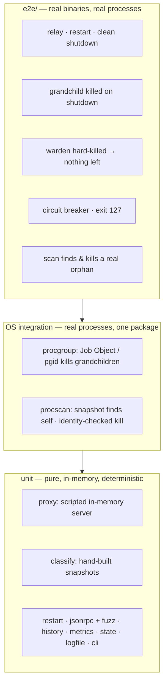

# Testing

```bash
make test        # everything (unit + e2e), ~15s
make race        # same with -race (needs cgo; CI runs it on Linux, macOS and Windows)
make cover       # coverage summary
make bench       # proxy overhead
go test -run TestCrash -v ./internal/proxy/   # one test
```

## Strategy



The rule: **policy is pure, I/O is thin.** Everything that makes a decision is tested
without touching the OS, so it's fast and deterministic. The OS-facing code is small enough
that a handful of real-process tests cover it.

### Proxy: an in-memory MCP server

`internal/proxy` depends on a `Child` interface, not on `exec.Cmd`. The tests implement it
with `io.Pipe`s and a scripted server whose behavior is chosen per generation:

```go
h := start(t, func(gen int) behavior { return behavior{ignoreInit: gen == 2} }, nil)
h.handshake()
h.send(`{"jsonrpc":"2.0","id":2,"method":"crash"}`)   // gen 1 dies
h.expectID("2")                                       // → server_restarted
h.send(`{"jsonrpc":"2.0","id":3,"method":"tools/list"}`)
// gen 2 ignores the replayed initialize → init timeout → gen 3 serves id 3
```

Each spec requirement for the proxy has a test: byte-for-byte relay, in-flight failure,
handshake replay order and swallowed response, `list_changed`, circuit breaker, buffer
overflow, late responses to a dead generation, cancellation, grace-period kill, replay
timeout, oversized messages, malformed output, spawn failure and context cancellation.

### Classification: hand-built snapshots

`internal/classify` takes `[]procscan.Process` and returns verdicts, so tests describe
entire machines as data, such as a Windows desktop with Claude, a warden, an orphaned
`npx → node` pair, and a server started from Windows Terminal. Every class is covered,
along with PID reuse, re-parenting to init and to a systemd user subreaper, orphans behind
a live wrapper, Claude Code's `--mcp-config`, and pattern boundaries.

### Framing: fuzzing

`FuzzReader` checks that the framer never returns a line over the limit and always reaches
EOF. Run it longer with:

```bash
go test -fuzz=FuzzReader -fuzztime=60s ./internal/jsonrpc/
```

### End-to-end: the fake server

`internal/fakeserver` is a small real MCP server whose failure modes are picked with
environment variables:

| Variable | Effect |
|---|---|
| `FAKE_CRASH_ON_START=1` | exit 1 immediately |
| `FAKE_GRANDCHILD_PIDFILE=p` | spawn a long-lived child, write its PID to `p` |
| `FAKE_ORPHAN_PIDFILE=p` | spawn a long-lived child, write its PID, then exit (leaving an orphan) |
| method `crash` | exit 1 when called |

`e2e.TestMain` builds both `mcp-warden` and `fake-mcp-server` (the `mcp` in the name makes
it match the default scan patterns), then drives the real binary over pipes. The orphan
test uses `--pid` so it can never kill a real orphan on a developer's machine.

### Platform-specific expectations

| Test | Windows | Linux | macOS |
|---|---|---|---|
| Hard-killed warden leaves nothing | kernel kills the job | `reap` cleans up | `reap` cleans up |
| Orphan classified `orphaned` | ✅ | ✅, or skipped if a container's subreaper (tini, containerd-shim) adopts it, which is legitimately `detached` | ✅ |

## Manual verification

These acceptance checks from SPEC-001 need a real client:

1. Wrap a server in Claude Desktop's config, restart Claude, and use its tools.
2. Kill the server's `node` process in Task Manager, then use a tool again. Expect one
   error at most, then success. `mcp-warden status` shows `RESTARTS 1`.
3. End the `mcp-warden.exe` task. No `node.exe` from that server should remain.
4. Quit Claude. All `mcp-warden` and server processes should be gone within ~4s.

Checks 2 and 4 have also been verified with a scripted client against a real Python MCP
server (12 tools). The kill-and-restore round trip took about 2.5s, almost all of it Python
start-up, and shutdown took 0.2s. Check 3 is covered on every CI run by
`TestHardKilledWardenLeavesNothingBehind`.
